# Beijing PM2.5 — End-to-End Forecasting Pipeline

> Generated by `python run.py all` from UCI dataset 381: 43,824 hourly observations
> at the US Embassy monitor in Beijing, 1 January 2010 to 31 December 2014.

## 1. Executive summary

- **Task:** predict hourly PM2.5 and flag heavy-pollution hours (>150 µg/m³).
- **Data:** 43,824 hours, **2,067** missing targets
  (4.72%); mean 98.6 µg/m³, 95th percentile
  284, maximum 994.
- **Split:** time-ordered. Train ≤ 2013, test = 2014. No random split, no shuffling.
- **Weather-only model** (usable without a PM sensor): RMSE **69.06**
  µg/m³, R² **0.455** — better than climatology
  (93.53).
- **With recent PM2.5 history:** RMSE **21.24** vs persistence
  **22.09** — only **0.85 µg/m³ (3.8%)**
  better than "the next hour looks like this hour".
- **Episode detection:** at the 150 threshold the lagged model recalls
  **90.1%** of heavy-pollution hours with precision
  90.6%; the weather-only model recalls
  47.3%.

## 2. Dataset and validation

| Check | Result |
| --- | --- |
| Rows | 43,824 |
| Period | 2010-01-01 00:00:00 → 2014-12-31 23:00:00 |
| Duplicate timestamps | 0 |
| Gaps larger than 1 hour | 0 |
| Missing targets | 2,067 (4.72%) |
| Heavy-pollution hours | 8,991 (20.5%) |
| Checks executed | 12 |

The file is genuinely hourly and complete: 43,824 rows cover
five calendar years including the 2012 leap day, with **zero duplicate timestamps and
zero missing hours**. Only the target is absent in places, and it is absent as the
literal token `NA`.

## 3. Cleaning and the missing-target policy

| Year | Mean PM2.5 | Median | Hours |
| --- | --- | --- | --- |
| 2010 | 104.0 | 79.0 | 8,091 |
| 2011 | 99.1 | 71.0 | 8,032 |
| 2012 | 90.5 | 69.0 | 8,295 |
| 2013 | 101.7 | 71.5 | 8,678 |
| 2014 | 97.7 | 72.0 | 8,661 |

- **No imputation.** 2,067 target values are missing in
  214 runs; the longest runs are
  [155, 127, 99, 91, 76] consecutive hours. Interpolating across them would
  invent the very spikes the model exists to catch, so those rows are dropped at the
  feature-matrix stage while remaining visible in the EDA.
- **No clipping in practice.** Every value already lies inside its physical range; the
  bounds are guard rails against future file edits.
- **Wind direction is categorical, not ordinal.** `cv` means calm/variable, so
  encoding NW < NE < SE < cv as numbers would be wrong.
- **`Iws` is a cumulative wind run.** Its scale depends on the averaging window and it
  is heavily right-skewed, hence `log1p`.

## 4. Exploratory findings

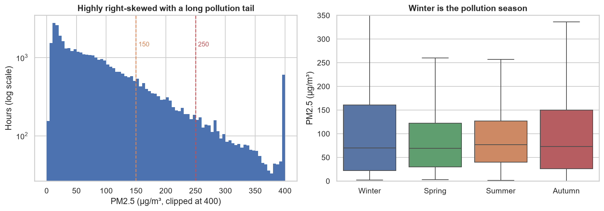

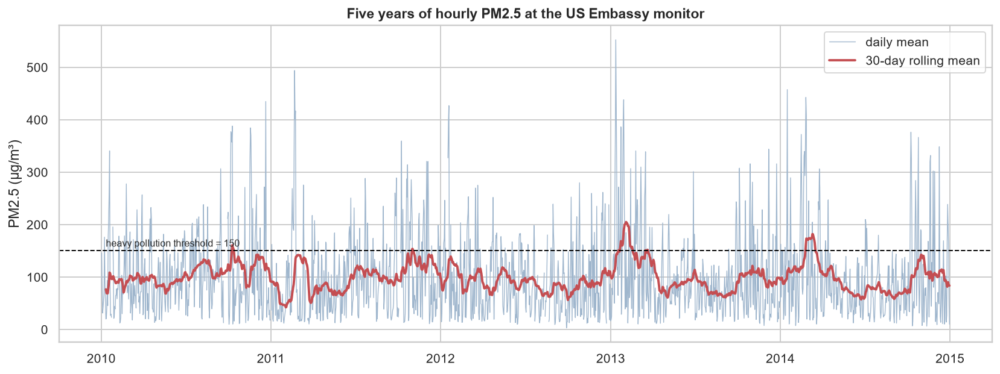

| Feature | Correlation with PM2.5 |
| --- | --- |
| `dew_point_depression` | -0.437 |
| `log_wind` | -0.316 |
| `Iws` | -0.248 |
| `DEWP` | +0.171 |
| `TEMP` | -0.090 |
| `Ir` | -0.051 |
| `pressure_anomaly` | -0.047 |
| `PRES` | -0.047 |

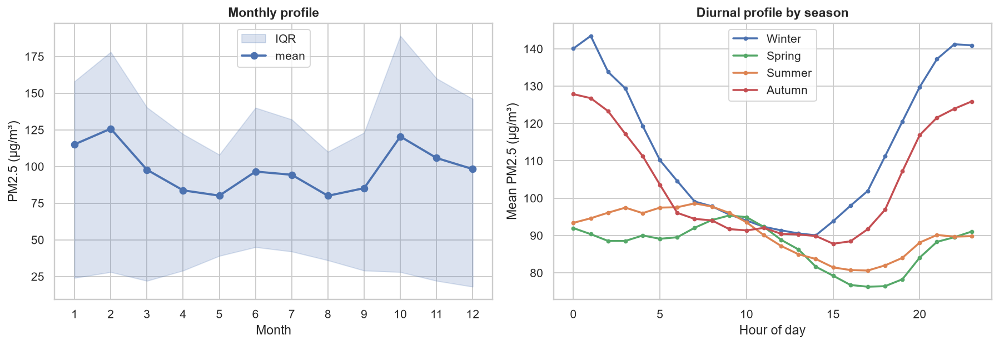

Winter means reach 115
µg/m³ against
94
in July; the diurnal cycle is shallow compared with the seasonal one. Weekends
(102.0) are close to weekdays
(97.3), so traffic is not the
dominant driver at this monitor.

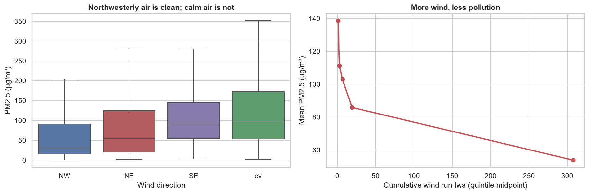

North-westerly air averages
70.1 µg/m³ against
126.2 when the wind is
calm — ventilation, not emission, is the first-order control on concentration.

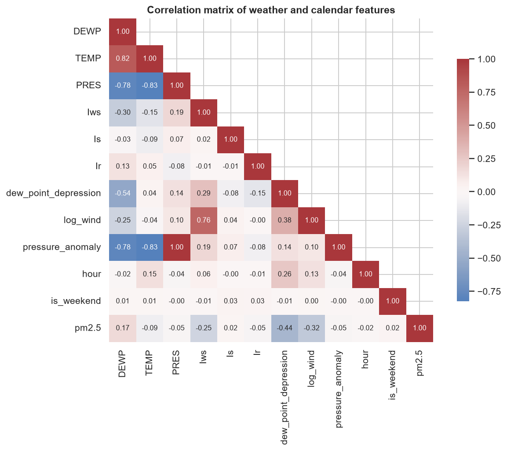

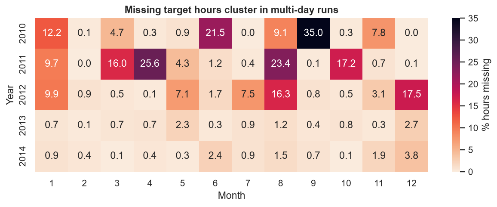

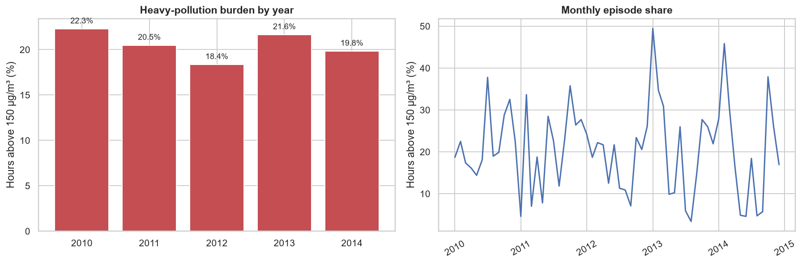

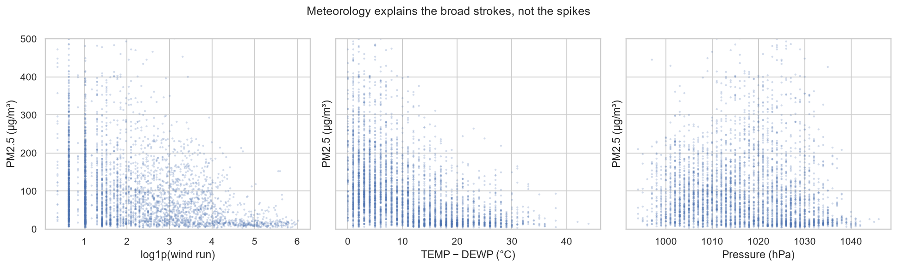

## 5. Modelling

### 5.1 Why the split is time-ordered

A random split would put 14:00 in the training set and 13:00 in the test set, so a
lag-1 feature would leak the answer and R² would look excellent for a model that cannot
be deployed. Here every test row lies strictly after every training row, and
cross-validation uses `TimeSeriesSplit`.

### 5.2 Hold-out performance (2014)

| Scenario | Features | RMSE | MAE | R² | Within 25 µg/m³ |
| --- | --- | --- | --- | --- | --- |
| `weather_only` | 15 | 69.06 | 47.06 | 0.455 | 43.2% |
| `with_lags` | 24 | 21.24 | 12.02 | 0.948 | 89.2% |

Reference forecasts: climatology RMSE **93.53**, persistence
RMSE **22.09**, persistence R²
**0.944**.

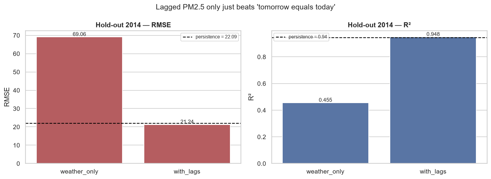

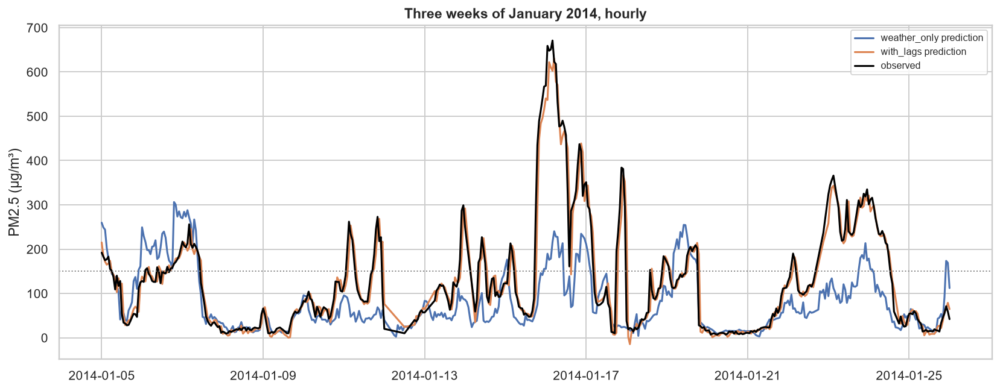

The lagged model tracks the shape of the series but smooths the peaks; the weather-only
model reproduces the seasonal envelope and misses short episodes. Both are honest about
what meteorology alone can do.

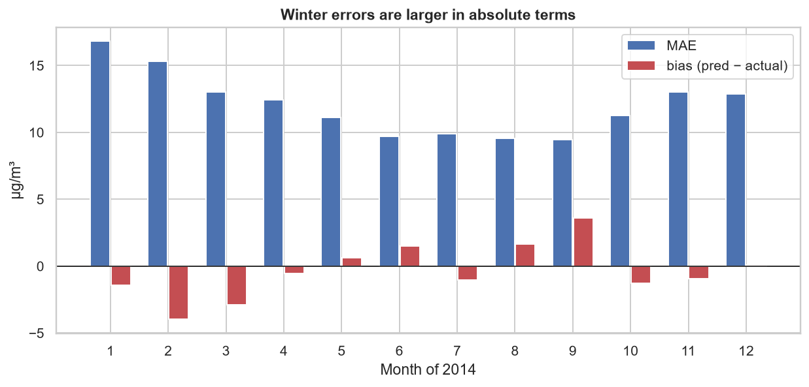

### 5.3 Episode detection

| Model | Precision | Recall | F1 | Missed | False alarms |
| --- | --- | --- | --- | --- | --- |
| `weather_only` | 0.618 | 0.473 | 0.536 | 915 | 509 |
| `with_lags` | 0.906 | 0.901 | 0.903 | 165 | 157 |
| persistence | 0.903 | 0.903 | 0.903 | 163 | 163 |

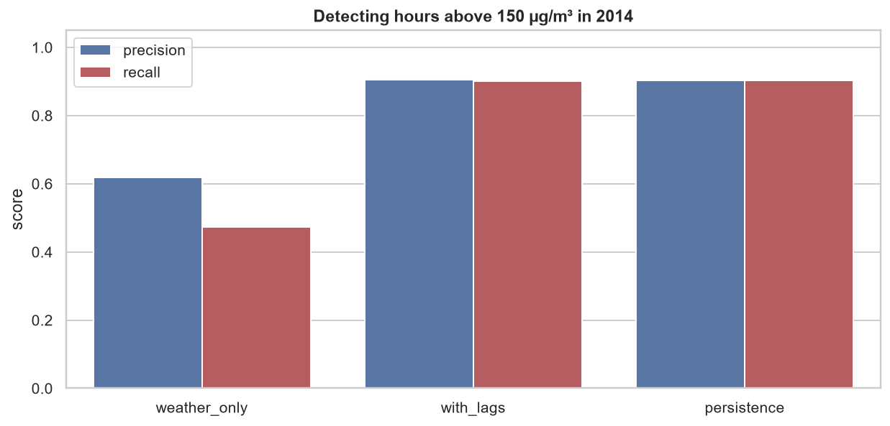

Recall is the metric that matters for a health warning. The lagged model catches most
heavy hours but still misses 165 of them, and the
weather-only model misses 915 — a reminder that
forecasting the tail is materially harder than forecasting the mean.

### 5.4 What drives the forecast

| Feature | Importance |
| --- | --- |
| `pm_lag_1` | 62.9594 |
| `pm_diff_24` | 31.3904 |
| `pm_lag_24` | 28.0278 |
| `pm_lag_3` | 8.3631 |
| `pm_roll_24` | 4.2946 |
| `log_wind` | 3.9404 |
| `cbwd_SE` | 3.6079 |
| `hour_sin` | 3.5416 |
| `dew_point_depression` | 3.3562 |
| `cbwd_NW` | 3.3526 |

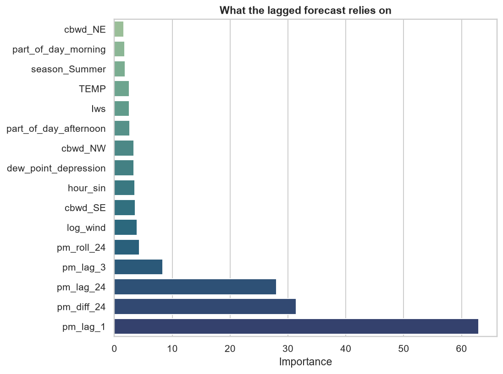

## 6. Interpretation and limitations

1. **Persistence is a strong baseline.** An RMSE near
   22 µg/m³ is hard to beat because pollution is
   autocorrelated. Reporting an R² of 0.95 without that baseline
   overstates the value added.
2. **No meteorology from outside the monitor.** The dataset has no emissions, traffic,
   heating or boundary-layer height, which limits the achievable skill.
3. **One monitor, one city, five years.** Conclusions do not transfer to other regions
   or to the post-2013 air-quality regime without revalidation.
4. **Tail under-prediction.** Regression to the mean shrinks peaks; quantile loss or a
   dedicated episode classifier would serve warning systems better.
5. **Missing target hours are not random.** Multi-day gaps cluster in winter, so the
   remaining sample slightly under-represents the worst episodes.
6. **No causal claims.** Wind direction correlates with concentration; it is a marker
   for air-mass origin, not a lever.

## 7. Reproducing

```bash
pip install -r requirements.txt
python run.py all
```

Regenerates every figure, `reports/metrics.json`, this report and the model card. The
notebook is built with `python scripts/build_notebook.py`.
